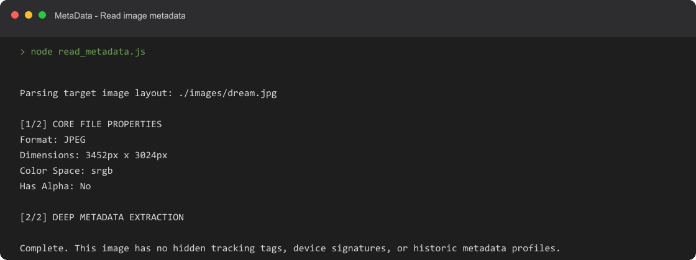
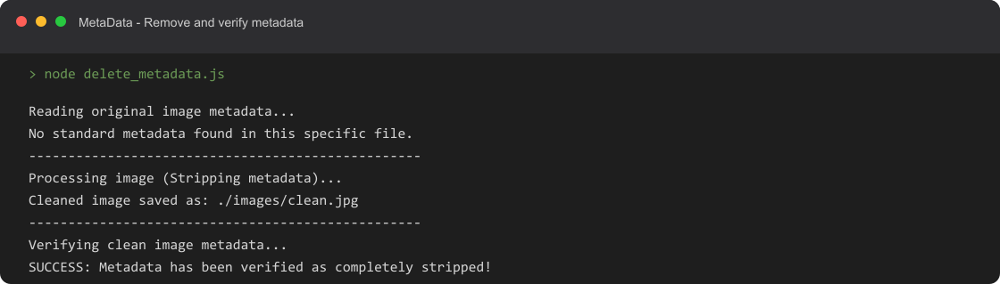

# MetaData

Inspect image metadata and create a copy with embedded metadata removed.

[](./LICENSE)
[](https://github.com/M003aad/MetaData.Js/releases/tag/v1.0.0)
[](https://nodejs.org/)
[](https://github.com/M003aad/MetaData.Js/actions/workflows/ci.yml)

## Table of contents

- [Overview](#overview)
- [Features](#features)
- [Screenshots](#screenshots)
- [Codebase](#codebase)
- [Installation and setup](#installation-and-setup)
- [Usage](#usage)
- [Scripts](#scripts)
- [Contributing](#contributing)
- [Security](#security)
- [License](#license)

## Overview

MetaData is a small command-line utility written in JavaScript using Node.js ES modules. It uses [Sharp](https://sharp.pixelplumbing.com/) to inspect and rewrite images and [exif-reader](https://www.npmjs.com/package/exif-reader) to decode EXIF data. There is no browser extension, frontend, server, or build step in this repository.

The scripts use fixed paths: both read `images/dream.jpg`, and the metadata-removal script writes `images/clean.jpg`. The `images/` directory is ignored by Git, so provide your own input image after cloning.

## Features

- Prints image format, dimensions, color space, and alpha-channel support.
- Reports and decodes EXIF data when present.
- Reports embedded XMP and ICC metadata when present.
- Rewrites the input image with Sharp's default metadata-stripping behavior.
- Checks the rewritten image for EXIF, ICC, XMP, and IPTC metadata blocks.

## Screenshots

The following captures show the scripts' console output when run against the local `images/dream.jpg` sample:

### Read image metadata



### Remove and verify metadata



## Codebase

```text
.
├── .github/
│   ├── ISSUE_TEMPLATE/
│   └── workflows/
├── images/                 # Local input/output images; ignored by Git
├── screenshots/            # Captured command output shown below
├── delete_metadata.js
├── read_metadata.js
├── package.json
├── package-lock.json
├── LICENSE
└── README.md
```

| Path | Purpose |
| --- | --- |
| `read_metadata.js` | Reads `images/dream.jpg` and reports image properties and supported metadata blocks. |
| `delete_metadata.js` | Creates `images/clean.jpg` and checks for remaining EXIF, ICC, XMP, and IPTC blocks. |
| `package.json` | Declares the npm scripts and runtime dependencies. |
| `package-lock.json` | Locks the npm dependency tree. |
| `images/` | Local image input and generated output. This directory is ignored and not included in a clone. |
| `.github/workflows/` | Continuous-integration and tagged-release workflows. |

## Installation and setup

### Requirements

- Node.js 20.9 or newer (required by the installed Sharp dependency).
- npm.
- A supported input image at `images/dream.jpg`.

### Install

```bash
git clone https://github.com/M003aad/MetaData.Js.git
cd MetaData.Js
npm ci
```

Create the local image directory and copy an image to the expected input path:

```bash
mkdir images
# Copy an image you want to inspect to images/dream.jpg
```

The `images/` directory is intentionally excluded from Git. The input image is not distributed with a fresh clone.

## Usage

Inspect the sample image:

```bash
npm run read
```

Create a metadata-stripped copy and verify it:

```bash
npm run delete
```

The second command writes the result to `images/clean.jpg`. It does not overwrite `images/dream.jpg`. Review the output carefully before sharing it; image rewriting may change image encoding or appearance, and metadata verification is limited to the blocks checked by the script.

To use a different source image, update the `TEST_FILE` constant in `read_metadata.js` and the `INPUT_IMAGE` constant in `delete_metadata.js`.

## Scripts

| Command | Description |
| --- | --- |
| `npm run read` | Reads image properties and reports EXIF, XMP, and ICC data from `images/dream.jpg`. |
| `npm run delete` | Writes a copy to `images/clean.jpg` and checks for EXIF, ICC, XMP, and IPTC blocks. |

There are no separate lint, test, or build scripts in `package.json`.

## Contributing

Bug reports, feature proposals, and pull requests are welcome. See [CONTRIBUTING.md](./CONTRIBUTING.md) for setup and contribution guidance.

## Security

Please report suspected vulnerabilities privately. See [SECURITY.md](./SECURITY.md) for reporting channels and response expectations.

## License

This project is licensed under the GNU Affero General Public License v3.0 only. See [LICENSE](./LICENSE). Maintained by M003aad.
